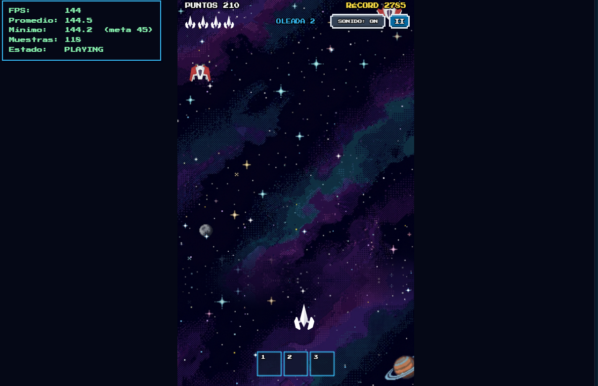
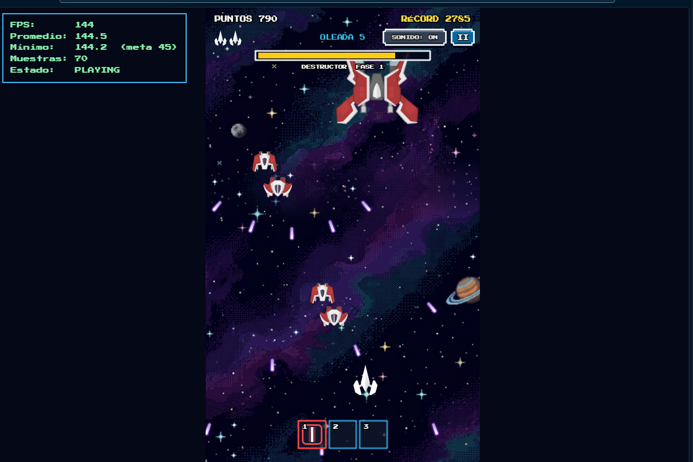
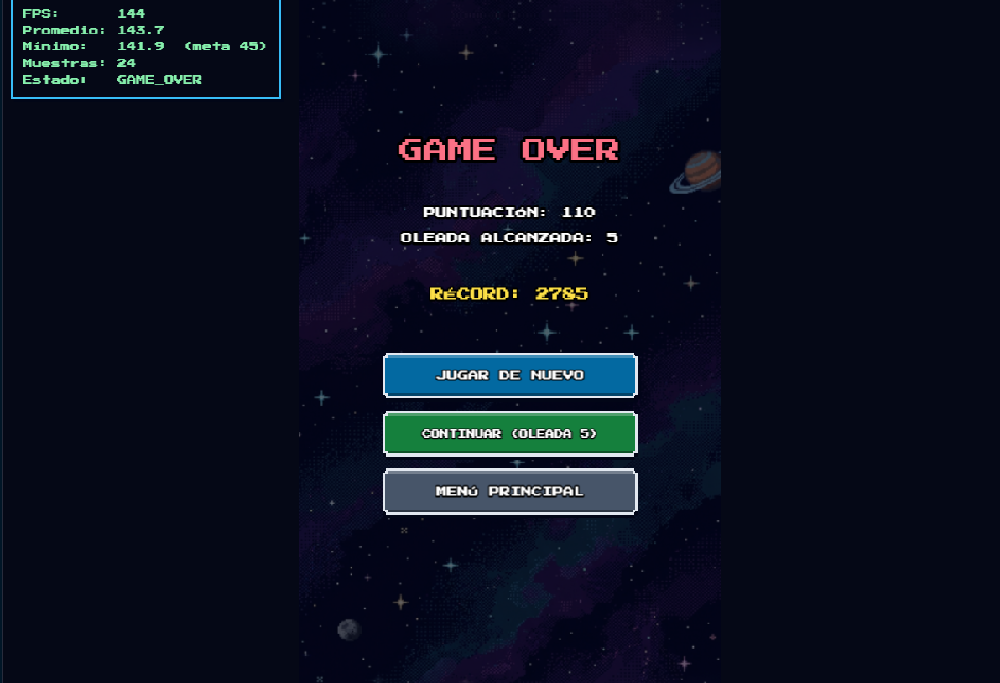
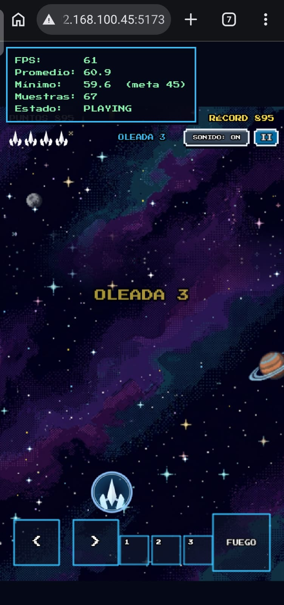
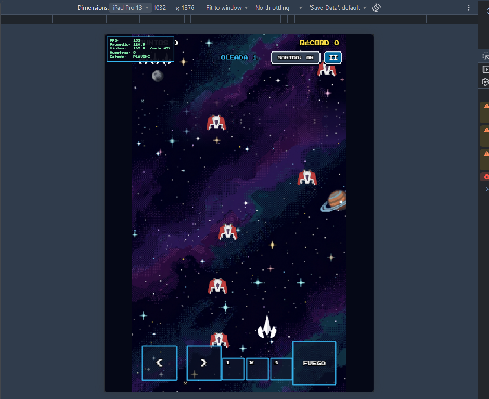
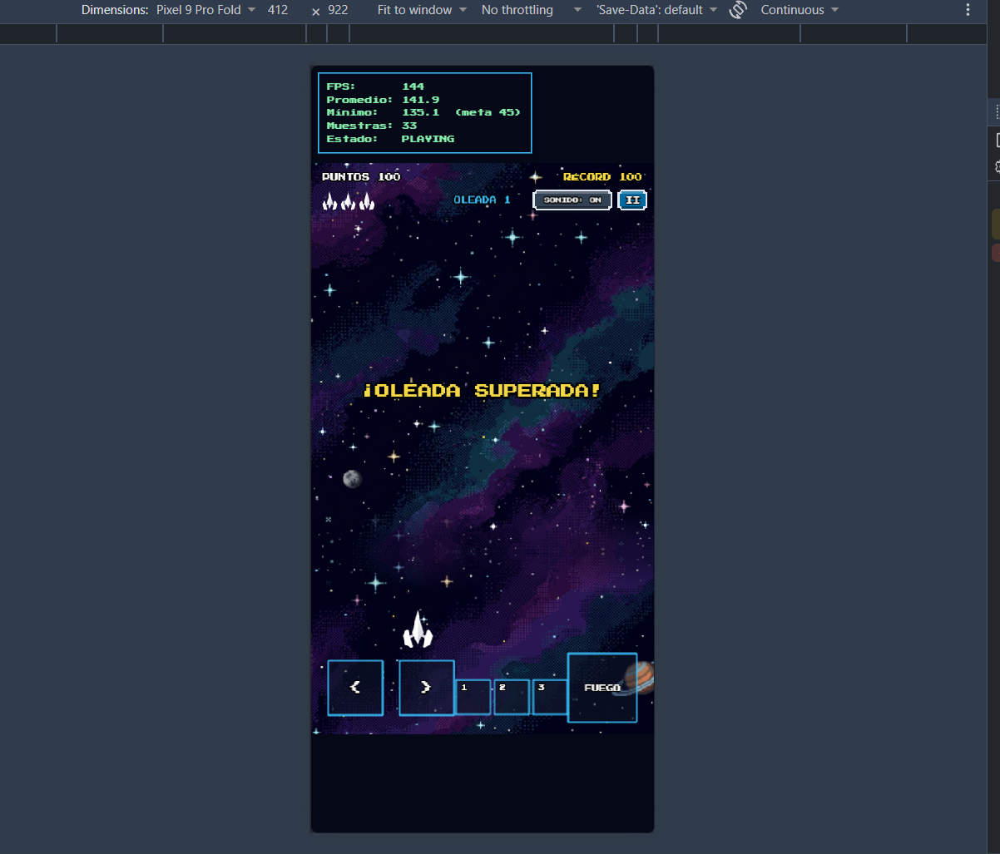

# Star Defender

Videojuego **Arcade Shooter** hecho con **Phaser 3 + JavaScript + Vite**.
Proyecto del primer bimestre — Aplicaciones Web (Ingeniería en Software).

Defiende la galaxia: sobrevive 5 oleadas, recoge power-ups y armas especiales, y derrota al jefe final **DESTRUCTOR**.

## Requisitos
- Node.js 20.19+ o 22.12+

## Ejecutar
```bash
npm install
npm run dev        # abre http://localhost:5173
```
Compilar: `npm run build` y luego `npm run preview`.

Para jugar desde un celular en la misma red Wi-Fi: `npx vite --host` y abrir en el celular la dirección `Network:` que aparece.

## Controles
| Acción | Teclado | Móvil / tablet |
| --- | --- | --- |
| Mover | Flechas o A / D | botones `<` y `>` |
| Disparar | Espacio (o flecha arriba) | botón FUEGO |
| Activar arma del inventario | 1, 2, 3 (también teclado numérico) | tocar el espacio del inventario |
| Pausa | P o ESC | botón `II` |
| Sonido on/off | M | botón SONIDO |
| Medidor de FPS | F (o abrir con `?fps` en la URL) | abrir con `?fps` en la URL |

## Reglas
- 3 vidas (máximo 5). Chocar con enemigos o recibir balas quita una vida (1.6 s de invulnerabilidad).
- **Power-ups** (caen al destruir enemigos): amarillo = disparo triple (8 s), azul = escudo, verde = vida extra.
- **Enemigos:** *grunt* (recto), *weaver* (zigzag), *gunner* (dispara al jugador) y el jefe final en la oleada 5.
- Superar una oleada da un bonus de 100 × número de oleada.
- **Victoria:** derrotar al jefe. **Derrota:** quedarse sin vidas.

## Inventario y armas temporales
Los enemigos (10% de probabilidad) y el jefe (en cada cambio de fase) sueltan **cajas de arma**. El jugador las guarda en un
inventario de **3 espacios** (parte inferior de la pantalla) y las activa cuando quiere.

| Arma | Efecto | Duración |
| --- | --- | --- |
| Láser | Rayo continuo que atraviesa y daña a todos los enemigos que toca | 8 s |
| Misiles | Misiles teledirigidos que buscan al enemigo más cercano | 10 s |
| Onda de choque | Borra las balas enemigas y daña a todos los enemigos en pantalla | Un solo uso |

Solo puede haber un arma temporal activa a la vez; mientras dura reemplaza el disparo normal y una barra muestra el
tiempo restante. La pausa no gasta la duración. Detalle completo: [docs/INVENTARIO.md](docs/INVENTARIO.md).

## Jefe final: DESTRUCTOR
Aparece en la oleada 5 con aviso **¡PELIGRO!** y cambia de fase según la vida que le queda:

| Fase | Vida | Ataque | Barra |
| --- | --- | --- | --- |
| 1 | 100% a 60% | Abanico de 5 balas | Amarilla |
| 2 | 60% a 30% | Ráfagas dirigidas al jugador y 2 escoltas cada 5 s | Naranja |
| 3 (furia) | menos de 30% | Disparo en espiral, más velocidad y tinte rojo | Roja |

Cada cambio de fase tiene banner, temblor de pantalla, explosión, sonido y suelta una caja de arma.
Detalle y cómo probarlo rápido: [docs/JEFE_FINAL.md](docs/JEFE_FINAL.md).

## Persistencia (localStorage)
High score, oleada alcanzada (botón "Continuar") y configuración de audio (mute).

## Estructura
```
src/
├── main.js              # configuración de Phaser y arranque
├── config.js            # constantes del juego (enemigos, jefe, armas, inventario)
├── scenes/              # Preload, Menu, Game, Pause, GameOver
├── objects/             # Player, Enemy, Boss, Bullet, PowerUp, WeaponCrate, Missile
├── ui/                  # Button, HUD, InventoryHUD, TouchControls, FpsMeter
├── managers/            # WaveManager, StorageManager, GameStateManager, InventoryManager
├── physics/             # registro de colisiones/overlaps
├── audio/               # AudioManager (música y efectos con archivos reales)
└── assets/              # WeaponTextures (sprites de armas por código), TextureFactory (respaldo, sin uso)
public/assets/
├── images/              # sprites: nave, enemigos, jefe, balas, power-ups, fondo
├── audio/               # música y 7 efectos de sonido
└── data/levels.json     # datos de las oleadas
docs/                    # capturas, pruebas, inventario, jefe y autoevaluación
```

## Arquitectura
`Scene Manager → Game Objects → Physics → UI/HUD → Audio Manager → Storage Manager`

| Capa | Archivos |
| --- | --- |
| Scene Manager | `main.js` y `scenes/` |
| Game Objects | `objects/` |
| Physics | `physics/collisions.js` (Arcade Physics con pooling de objetos) |
| UI/HUD | `ui/` |
| Audio Manager | `audio/AudioManager.js` |
| Storage Manager | `managers/StorageManager.js` |
| Estados | `managers/GameStateManager.js` |
| Oleadas | `managers/WaveManager.js` + `public/assets/data/levels.json` |
| Inventario | `managers/InventoryManager.js` |

### Sistema de estados
`managers/GameStateManager.js` guarda el estado global de la partida y solo permite cambios válidos:

```
LOADING → MENU → PLAYING ⇄ PAUSED
                    ↓          ↓
               GAME_OVER → MENU / PLAYING
```

Las escenas lo actualizan (`MenuScene` → MENU, `GameScene` → PLAYING / PAUSED / GAME_OVER) y lo
consultan antes de actuar; por ejemplo, solo se puede pausar en PLAYING.

## Rendimiento
Pooling de objetos (balas, enemigos, power-ups, cajas y misiles se reutilizan), sprites ligeros (menos de 10 KB cada
uno, salvo el fondo de 740 KB), todos los assets cargados una sola vez en `PreloadScene` con barra de progreso, un solo
emisor de partículas y tiempos de armas calculados con `delta`. Peso total de `public/assets/`: unos 8 MB, de los cuales
la música ocupa 5.8 MB.
**Resultados medidos** (detalle y capturas en [docs/PRUEBAS.md](docs/PRUEBAS.md)):

| Dispositivo | FPS promedio | FPS mínimo | Meta |
| --- | --- | --- | --- |
| PC ASUS TUF A15 (Ryzen 7 serie 7000, RTX 4050) | 144.5 | 144.2 | ≥ 45 ✔ |
| Celular real RedMagic 8 Pro (Chrome Android) | 60.9 | 59.6 | ≥ 45 ✔ |

Carga en la PC: 1.66 s hasta tener todos los archivos.

## Capturas
| En juego (oleada) | Jefe final e inventario | Game Over con récord |
| --- | --- | --- |
|  |  |  |

| Celular real con controles táctiles | Tablet (iPad Pro 13) | Móvil (Pixel 9 Pro Fold) |
| --- | --- | --- |
|  |  |  |

Las capturas se tomaron con el medidor de FPS activo (panel de la esquina superior izquierda).
Descripción de cada una: [docs/CAPTURAS.md](docs/CAPTURAS.md).

## Integrantes
| Integrante | Responsabilidad |
| --- | --- |
| Dylan | Jefe final con 3 fases y video demo |
| Ronny | Líder técnico, imágenes y audio reales, estilo retro, repositorio y entrega final |
| Santiago Guamán | Sistema de inventario y armas temporales |
| Kened Lugmana | Sistema de estados, medidor de FPS, pruebas de rendimiento y móvil, documentación y autoevaluación |

Autoevaluación: [docs/AUTOEVALUACION.md](docs/AUTOEVALUACION.md).

## Créditos
- **Código:** propio, escrito por el equipo. No se usaron templates ni proyectos de internet.
- **Motor:** [Phaser 3](https://phaser.io) (licencia MIT) y [Vite](https://vite.dev) (licencia MIT).
- **Imágenes y audio** (`public/assets/`): recursos gratuitos de [Kenney](https://kenney.nl) y
  [OpenGameArt](https://opengameart.org).
- **Sprites de armas** (cajas, misil y rayo láser): generados por código en `src/assets/WeaponTextures.js`.
- **Fuente:** [Press Start 2P](https://fonts.google.com/specimen/Press+Start+2P) de Google Fonts (SIL Open Font License).
